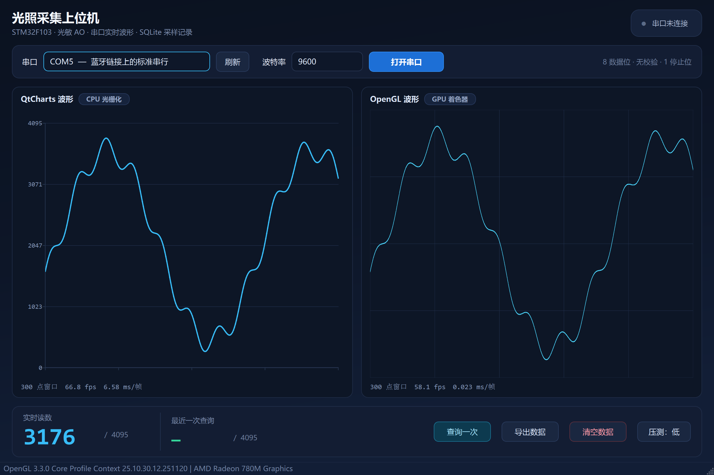
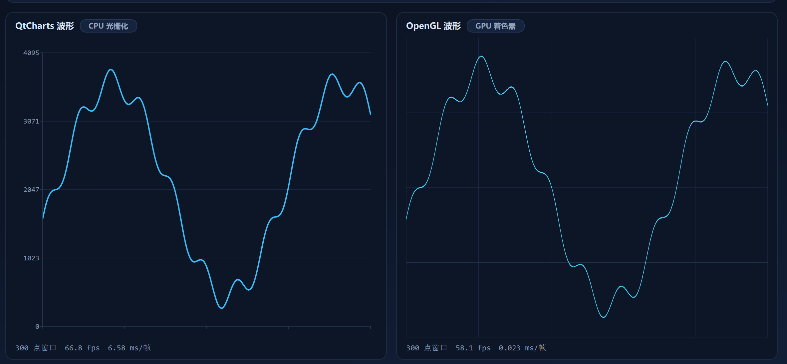

# AoMonitor — STM32 光照强度采集上位机

基于 **Qt 6 / Widgets** 的桌面串口上位机，配套 STM32F103C8T6 光敏采集节点：实时显示 ADC 光照值、绘制滚动波形、按需存库、导出 CSV。
界面为深色仪表盘风格（QSS 主题化），并内置一条 **OpenGL + GLSL 着色器** 的波形渲染路径，与 QtCharts 并排跑同一份数据做性能对比。

下位机固件代码见同级仓库 `STM32-LightSensor`（江协科技 9-2 工程改造：光敏 DO 控蜂鸣器 + AO 上 OLED + AO 串口上报）。

---

## 下载即用（Windows x64 免安装）

| 版本 | 内容 | 链接 |
|---|---|---|
| **v1.1.0**（最新） | 深色界面 + OpenGL 双路波形对比 | [AoMonitor-1.1.0-win64.zip](https://github.com/carson631/AOMonitor/releases/latest) |
| v1.0.0 | 首个可运行版本（功能可用、浅色界面） | [releases](https://github.com/carson631/AOMonitor/releases) |

解压后直接双击 `AoMonitor.exe`，无需安装 Qt（运行时 DLL 已随包）。数据库 `ao_data.db` 会自动生成在同目录。

> 直连 GitHub 下载慢时，可在地址前加镜像前缀：`https://gh-proxy.com/` + 原下载链接。

---

## 功能

| 功能 | 说明 |
|---|---|
| **串口枚举** | 启动自动扫描，`QSerialPortInfo` 枚举，显示 `COM4 — USB-SERIAL CH340`；跨平台（Linux 显示 `/dev/ttyUSB0`），无需改代码 |
| **打开 / 关闭串口** | 同一按钮二次点击为关闭；失败按错误类型给提示（`PermissionError` → 被其他程序占用，`DeviceNotFoundError` → 设备已拔出） |
| **连接状态胶囊** | 右上角圆点 + 文字实时反映连接状态（绿点=已连接），按钮同步变红显示「关闭串口」 |
| **实时数值** | 大号等宽数字显示每帧光照值（12 位 ADC，0~4095，四位定宽零填充，位数变化时不抖动），约 5 帧/秒 |
| **滚动波形** | QtCharts `QLineSeries`，横轴窗口固定 300 点，满后整体左滚（示波器手感），纵轴 0~4095 |
| **OpenGL 双路对比** | 并排一个 `QOpenGLWidget` 波形（VAO + VBO + GLSL），同一份数据、各自卡片脚注显示 fps 与单帧耗时；「压测」按钮三档调节数据率 |
| **查询一次** | 向上位机发一个字节，STM32 收到任意字节立即补发一帧 → 立刻刷新查询值并写入数据库 |
| **按需入库** | SQLite 单文件 `ao_data.db`，**只有点「查询一次」的那一帧才入库**，200 ms 自动帧不落库，避免刷屏 |
| **导出 CSV** | 全表导出，UTF-8 + BOM，Excel 打开中文不乱码 |
| **清空数据** | 二次确认后 `DELETE FROM light_log` |
| **深色主题** | 全部观感集中在 `theme.qss`（卡片/圆角/字号/按钮层级）+ Fusion 深色调色板，改配色只需动一个文件 |

---

## 界面截图



> 布局：标题栏（标题 / 副标题 / 连接状态胶囊）→ 串口设备卡片 → 左右波形卡片（QtCharts / OpenGL）→ 数据卡片（实时读数 / 最近一次查询 / 操作按钮）。

---

## 界面主题怎么做的

分两层，**样式与业务完全解耦**：所有控件 objectName 保持原样，QSS 只按 `#objectName` 选择器改外观，没有为美观改动任何逻辑。

| 层 | 位置 | 负责什么 |
|---|---|---|
| 调色板 | `main.cpp: applyTheme()` | Fusion 风格 + 完整深色 `QPalette`，管住样式表覆盖不到的原生控件：下拉箭头、菜单、滚动条、工具提示 |
| 样式表 | `theme.qss`（经 `theme.qrc` 编译进 `:/theme.qss`） | 卡片底色/圆角/描边、字号层级、按钮主次与悬停、状态胶囊、数值配色 |

几个具体做法：

- **卡片式分组**：`QFrame#deviceCard`、`chartCard`、`glCard`、`dataCard` 用 `background + border + border-radius` 做成卡片，窗口底色用 `qlineargradient` 竖向渐变；
- **按钮分级**：主操作「打开串口」实心蓝，`查询一次` 青色描边，`清空数据` 红色描边——靠 `#objectName` 区分，不改控件类型；
- **状态联动用动态属性**：连接后给按钮设 `connected=true`，再用 `style()->unpolish/polish` 触发重绘，QSS 里 `#openButton[connected="true"]` 才会生效（只改属性不 repolish 是不刷新的）；
- **数字从 `QLCDNumber` 换成 `QLabel`**：LCD 段码在深色底上对小尺寸不友好，换成 Consolas 40 px + `%1` 四位零填充，读数稳定、单位不左右跳；
- **QChart 深色化**：`setBackgroundVisible(false)` 让图表透明露出卡片底色，坐标轴 label/grid/line 全换深色，x 轴标签隐藏（滚动窗口下数字只会晃眼），y 轴 `%d`。
- **OpenGL 控件融入卡片**：`glClearColor` 取卡片同色 `#0d1626`，再加一套最简着色器画背景网格（顶点已是 NDC，静态 VBO，每帧只多一次 draw call）。

> ⚠️ 踩坑记录：卡片头部的 `QLabel` 默认 sizePolicy 带 `GrowFlag`，会把多余高度吃掉，导致徽标被拉成大方块、下面的波形区被顶下去。修法是标题/徽标/脚注一律 `vsizetype=Fixed`、波形控件 `Expanding`，并在代码里 `chartCardLayout->setStretch(1, 1)`、`glCardLayout->setStretch(1, 1)`。

---

## OpenGL 波形 vs QtCharts（同一份数据的双路对比）

界面上并排放了两个波形控件，**吃完全相同的采样数据**，用来量化两条渲染路径的差距：

| 分组 | 实现 | 每帧做什么 |
|---|---|---|
| QtCharts（CPU 光栅化） | `QLineSeries` + `QChartView` | 每个点一个绘图项，`append` / `removePoints` 维护内部索引，CPU 逐段光栅化 |
| OpenGL（GPU + 着色器） | `QOpenGLWidget` + VBO + GLSL 330 | 点写进环形缓冲，`glBufferSubData` 只传增量，`glDrawArrays` 一次画完 |



### 实现要点（`waveformglwidget.h/.cpp`）

- **3.3 Core Profile + VAO**：`initializeGL()` 里编译 shader、建 VAO/VBO，`paintGL()` 里只绑定 + 画
- **环形顶点缓冲**：65536 个 `vec2`（512 KB），x 分量固定为槽位号，数据只覆盖 y
- **增量上传**：记录上次绘制后的写入区间，只 `glBufferSubData` 这一小段；写指针跨过缓冲尾时拆成两段上传
- **坐标变换在顶点着色器**：`(槽位 - u_left) / u_span` 映射到 NDC，滚动时只改 uniform，不重建顶点
- **跨尾绘制**：可见窗口跨过缓冲尾时，第二段整体 `+65536` 后直接接在第一段后面，两次 `glDrawArrays`
- **线宽**：Core profile 下 `glLineWidth > 1` 不可靠，用三次 `u_yOffset` 微偏移叠出约 2.5 px；边缘靠 4× MSAA
- **60 Hz 固定节拍重绘**：滚动动画与数据到达解耦，数据停 800 ms 后自动停表，不空转
- **背景网格**：第二套最简着色器（顶点已是 NDC，`gl_Position = vec4(aPos, 0, 1)`）+ 静态 VBO（5 横 6 竖 `GL_LINES`），每帧只多一次 draw call，视觉上与左侧 QtCharts 的网格对齐

### 实测数据（AMD Radeon 780M / Windows 11 / Qt 6.8.3）

| 压测档位 | 数据率 | QtCharts | OpenGL |
|---|---|---|---|
| 关 | 串口 5 帧/秒 | 5 fps / <1 ms | 5 fps / 0.02 ms |
| 低 | ≈ 2 000 点/秒 | 67~73 fps / **6.2~6.6 ms/帧** | 55~63 fps / **0.022~0.024 ms/帧** |
| 中 | ≈ 3 000 点/秒（60 点/批） | 30 fps / **25 ms/帧** | 24 fps（被拖住） |
| 高 | ≈ 25 000 点/秒（500 点/批） | 4.5 fps / **210 ms/帧** | 4 fps（被拖住） |

**结论要说清楚**：单帧成本差 **300 倍以上**（6.2 ms vs 0.022 ms），但中/高档两边 fps 会一起掉——因为两个控件在**同一个 UI 线程**，QtCharts 每帧占 25~210 ms 把事件循环堵死，GPU 那条路根本没机会提交。

这正是最该记住的一点：**换 GPU 只解决了"画"，没解决"数据维护 + 事件循环阻塞"**。真要撑住高采样率，得把 QtCharts 移出关键路径（不画、降采样、或换掉），否则 GPU 再快也被拖平。

### 无人值守自测

```bash
# 启动即开压测、每秒打印帧率、6 秒后退出
AO_SELFTEST=6 AO_STRESS_LEVEL=1 ./AoMonitor.exe

# 顺便抓图（窗口整图 + GL 控件单独一帧）
AO_SELFTEST=6 AO_STRESS_LEVEL=1 AO_SCREENSHOT=D:/tmp/shot.png ./AoMonitor.exe
```

`AO_STRESS_LEVEL`：1 低 / 2 中 / 3 高。手动用时点「压测」按钮循环切档。

---

## 硬件接线

主控为 STM32F103C8T6 最小系统板，上位机通过 **CH340 USB-TTL** 与 MCU 的 USART1 相连。

| STM32 引脚 | 连接对象 | 说明 |
|---|---|---|
| PA9 (USART1_TX) | CH340 RX | 数据上报 |
| PA10 (USART1_RX) | CH340 TX | 接收上位机查询字节 |
| PA0 (ADC1_IN0) | 光敏模块 AO | 模拟量，`GPIO_Mode_AIN`，ADC1 通道 0 |
| PB13 | 光敏模块 DO | 数字量，上拉输入（模块 DO 为开漏输出） |
| PB12 | 有源蜂鸣器 | 低电平触发 |
| PB8 / PB9 | OLED (I2C) | SCL / SDA |

| 光敏模块 | STM32 |
|---|---|
| VCC | 3.3V |
| GND | GND |
| AO | PA0 |
| DO | PB13 |

**串口参数：9600 / 8-N-1，无流控。**

> ⚠️ 江协科技原始工程默认就是 9600；若你自己改过固件波特率，记得让这里的下拉框与 MCU 侧 `USART_BaudRate` 保持一致，否则会出现「串口已打开但一帧都收不到」。

---

## 串口协议

ASCII 文本帧，便于串口助手直接观察：

```
$DATA,<AO>#\r\n
```

| 字段 | 含义 |
|---|---|
| `$` | 帧头 |
| `DATA` | 固定标识 |
| `<AO>` | 十进制无符号整数，PA0 的 12 位 ADC 原始值，0~4095 |
| `#` | 帧尾 |
| `\r\n` | 换行（上位机解析时忽略） |

**上报节奏**

- MCU 每 **200 ms** 主动上报一帧；
- 上位机发来**任意字节**（本程序发 `?`），MCU **立即补发一帧**——「查询一次」按钮就靠这个约定实现。

示例：

```
$DATA,2048#
$DATA,512#
```

### 切帧为什么不能靠 `readAll()` 一次性解析

`QSerialPort::readyRead` 给的是**字节流不是消息流**：一次可能只收到半帧（`$DATA,20`），也可能一次收到三帧半。因此程序内部维护缓冲区：

1. 所有到达字节累积进 `m_rx`（上限 4096 字节，防止坏帧下无限膨胀）；
2. 找 `$` 定位帧头，丢掉之前的噪声；
3. 找 `#` 定位帧尾——**找不到就 `return` 保留缓冲，等下一批数据拼上**（新手最常写错的地方：这里清空缓冲会导致永远拼不出完整帧）；
4. 切出帧后按 `,` 取数值，`toLongLong(&ok)` 用 `ok` 判断解析成败，失败帧丢弃。

---

## TCP 数据源（配合 AOSimulator）

串口之外再开一路 **TCP 客户端**输入，协议完全相同（`$DATA,<AO>#\r\n`），
收到的字节喂给**同一个 `FrameParser`** —— 波形、大数字、入库、CSV 导出全部复用，
新增的只有一个连接管理类 `TcpClient`。

```
[数据源: 串口│TCP] ──► QSerialPort ─┐
                                    ├─► FrameParser::feed() ─► frameParsed ─► UI/DB
[数据源: TCP]  ──► TcpClient ───────┘      （切帧逻辑零改动）
```

### 使用

1. 设备卡片左上角「数据源」选 **TCP**（串口控件组会被隐藏）
2. 地址 `127.0.0.1`、端口 `9000`，点「连接 TCP」
3. 状态胶囊变绿显示 `TCP 127.0.0.1:9000`，波形开始滚动

### 与 AOSimulator 联调

```bash
# 终端 1：模拟器监听 9000，默认恒值 2048，200ms 一帧
AOSimulator.exe --autostart

# 终端 2：上位机自动连接（免手点，便于脚本化验证）
set AO_AUTO_TCP=127.0.0.1:9000
AoMonitor.exe
```

模拟器的四种坏帧注入可以直接验证上位机的健壮性：

| 模拟器注入 | 上位机应表现 |
|---|---|
| 无（恒值/正弦） | 波形连续，帧计数稳定 |
| 半包（帧切两段） | 不丢帧（缓冲重组成功） |
| 粘包（3 帧一包） | 一次 `feed` 解析出 3 帧 |
| 垃圾前缀 / 空值帧 | 坏帧被丢弃，已有波形不中断 |

> 注意：AOSimulator 是**单向广播**，不响应「查询一次」的下行 `?` 字节；
> 点击后会在状态栏说明，下一帧自然到达时照常入库。

### 两组控件为什么互斥"显示"而不是只禁用

串口组 + TCP 组同时排在设备卡片一行时，最小宽度合计约 **1540px**，
而卡片只有 **1160px**。早期版本只是 `setEnabled(false)`，结果布局被压到重叠——
串口下拉框里 `COM5 — 蓝牙链接上的标准串行` 的长文本溢出，糊在「波特率」标签上，
看起来像「标准波特率」重影（这个坑值得记：**布局溢出时控件会互相覆盖，不是简单挤压**）。
现在切换时直接 `setVisible()`，一次只放一组，宽度立刻富余。

同一个病根在小窗口下还会复发：窗口缩到最小 1000×680 时，串口组自身也放不下
（下拉框最小 280 + 波特率 120 + 右侧「8 数据位」说明文字）。对应两处调整：

- `chuankouBox` 最小宽 280 → 170（文本过长时按控件宽度裁切，布局不再被顶爆）
- `botelvBox` 最小宽 120 → 88
- 装饰性的「8 数据位 · 无校验 · 1 停止位」从布局里移除，改成设备卡片的 **tooltip**，
  信息不丢，也不占用那一行宝贵的水平空间

验证方式：`MoveWindow` 把窗口强制设成 1000×680，两种数据源各截一张图确认无重叠。

---

## 数据存储

SQLite 数据库文件与 exe 同目录（`QCoreApplication::applicationDirPath() + "/ao_data.db"`），首次启动自动建表：

```sql
CREATE TABLE IF NOT EXISTS light_log (
    id    INTEGER PRIMARY KEY AUTOINCREMENT,
    ts    TEXT    NOT NULL,   -- ISO8601 带毫秒，如 2026-10-28T19:20:31.402
    value INTEGER NOT NULL    -- AO 原始值 0~4095
);
```

写入使用 `prepare` + `bindValue` 参数化，不做字符串拼接（防注入、免转义）。

导出 CSV 时写 UTF-8 **BOM**，否则 Excel 打开中文表头会乱码。

---

## 依赖

| 项 | 版本 / 说明 |
|---|---|
| Qt | **6.5+**（开发使用 6.8.3 LTS） |
| Qt 模块 | `Core`、`Widgets`、**`SerialPort`**、**`Charts`**、**`Sql`** |
| 编译器 | Windows: MinGW 13.1 64-bit；Linux: GCC |
| 构建 | CMake ≥ 3.19 + Ninja（或 MinGW Makefiles / Make） |

> `SerialPort`、`Charts` 不在 qt6-base 里，必须单独安装：
>
> - 官方在线安装器：勾选 `Qt Serial Port` 与 `Qt Charts`
> - 命令行补装（aqtinstall）：
>   ```bash
>   python -m aqt install-qt windows desktop 6.8.3 win64_mingw -m qtserialport qtcharts -O D:/Qt --archives qtserialport qtcharts
>   python -m aqt install-qt linux desktop 6.8.3 linux_gcc_64 -m qtserialport qtcharts -O ~/Qt
>   ```
> - Ubuntu 包管理器：
>   ```bash
>   sudo apt install qt6-base-dev qt6-serialport-dev qt6-charts-dev libgl1-mesa-dev
>   ```

---

## 编译

### Windows（Qt Creator）

1. 打开 `CMakeLists.txt`，Configure Project 时选 `Desktop Qt 6.8.3 MinGW 64-bit`；
2. `Ctrl+B` 构建，`Ctrl+R` 运行。

### Windows（命令行）

```bash
# 把 MinGW、Qt、CMake、Ninja 加进 PATH
export PATH="/c/Program Files/CMake/bin:/d/Qt/Tools/mingw1310_64/bin:/d/Qt/6.8.3/mingw_64/bin:$PATH"

cmake -S . -B build-release -G Ninja \
      -DCMAKE_BUILD_TYPE=Release \
      -DCMAKE_PREFIX_PATH=D:/Qt/6.8.3/mingw_64
cmake --build build-release
```

配置期若打印 `Configuring with Qt 6.8.3 (major 6)`，说明找对了 Qt。

> 改配色：直接编辑 `theme.qss` 后重新构建即可 —— `theme.qrc` + `set(CMAKE_AUTORCC ON)` 会自动把它编进 `:/theme.qss`，不需要额外的部署步骤。

### Linux

```bash
sudo apt update
sudo apt install -y build-essential cmake ninja-build \
                    qt6-base-dev qt6-serialport-dev qt6-charts-dev \
                    libgl1-mesa-dev libxkbcommon-dev

cmake -S . -B build-linux -DCMAKE_BUILD_TYPE=Release
cmake --build build-linux -j$(nproc)
./build-linux/AoMonitor
```

Linux 上用串口需要 `dialout` 权限，**加完组必须重新登录**：

```bash
sudo usermod -aG dialout $USER
```

> ⚠️ Windows 与 Linux 的构建目录不可混用（`CMakeCache.txt` 存的是绝对路径），本工程约定 Windows 用 `build*`、Linux 用 `build-linux`。

---

## 使用步骤

1. 板子上电，跑固件（9600 波特率那版），CH340 插 USB；
2. 启动程序，串口下拉框选中 `COM4 — USB-SERIAL CH340`，波特率 `9600`；
3. 点 **打开串口** → 按钮变「关闭串口」，`AONumber` 每 200 ms 跳数，波形从左往右生长；
4. 遮挡/移开光源观察数值变化；
5. 点 **查询一次** → 发一个 `?`，STM32 立刻补发一帧，`AONumber_2` 更新且该值写入数据库；
6. **导出数据** → 选路径存 CSV；**清空数据** → 确认后清表。

数据库位置：exe 同目录 `ao_data.db`，可用 [DB Browser for SQLite](https://sqlitebrowser.org/) 打开查看。

### 常见问题

| 现象 | 原因 |
|---|---|
| 打开串口报「被其他程序占用」 | 串口被独占。关掉串口调试助手（UWP 版关窗不退出进程，需任务管理器结束）、另一份本程序实例、虚拟机 USB 直通 |
| 串口打开但一帧都收不到 | 波特率不匹配（本机固件应为 9600）；或 TX/RX 接反 |
| 数值恒为 0 或 4095 | AO 未接线 / 光敏模块供电异常；用万用表量 AO 对 GND 电压应在 0~3.3V 变化 |
| 波形不动 | 横轴窗口未跟随数据平移（QtCharts 横轴是真实数值，必须 `setRange(min, min+299)` 整体平移，只改一头会导致新数据落在可视范围外） |
| Linux 打开串口 `Permission denied` | 未加 `dialout` 组或未重新登录 |
| TCP「连接被拒绝」 | AOSimulator 没启动或端口不对（默认 9000）；同机环回不受防火墙影响，跨机需放行入站 |

---

## 目录结构

```
AOMonitor/
├── CMakeLists.txt          # Qt6 + SerialPort + Charts + Sql + OpenGL + OpenGLWidgets，AUTORCC 打包主题
├── main.cpp                # QApplication + applyTheme()（Fusion + 深色 QPalette + theme.qss）
├── mainwindow.h/.cpp       # 全部业务逻辑：串口、切帧、图表深色化、OpenGL 双路、数据库、导出
├── mainwindow.ui           # 卡片式布局；chartArea 提升为 QChartView，glArea 提升为 WaveformGLWidget
├── theme.qss / theme.qrc   # 界面主题（卡片、圆角、字号、按钮主次、状态胶囊），编译进 :/theme.qss
├── waveformglwidget.h/.cpp # QOpenGLWidget 波形：VAO + 环形 VBO + GLSL 330 + 网格 + 60Hz 重绘 + 帧率统计
├── tcpclient.h/.cpp        # TCP 数据源：连接管理 + 吐字节，不碰 UI，可与 QTcpServer 环回单测
├── tests/
│   ├── test_ao_monitor.cpp # FrameParser 27 用例
│   └── test_tcpclient.cpp  # TcpClient 7 用例（真实 TCP 环回，不 mock）
├── AoMonitor_zh_CN.ts      # 中文翻译源
├── dist/                   # windeployqt 打包产物（免安装即用）
└── README.md
```

### 关键设计点

- **`chartArea` 控件提升**：`.ui` 里放普通 `QWidget` 占位，Promote 成 `QChartView`（头文件 `<QtCharts/QChartView>`），界面仍可用 Designer 拖布局。
- **对象树管理内存**：`m_serial = new QSerialPort(this)`，父对象析构自动回收，`~MainWindow` 只 `delete ui`。
- **`m_pendingLog` 标志法**：点「查询一次」置位，下一帧解析成功即入库并清标志——200 ms 自动帧照常显示但不落库。
- **平台无关**：串口名走 `QSerialPortInfo::availablePorts()` 枚举，不硬编码 `COM4`，同一份代码 Windows/Linux 都能跑。
- **样式与逻辑解耦**：QSS 只按 objectName 选择器改观感，改主题不碰业务代码；`theme.qss` 走 Qt 资源编译进 exe，不额外增加部署文件。

---

## Roadmap

- [x] 深色主题 / 卡片式布局
- [x] OpenGL + GLSL 波形渲染与帧率对比
- [x] TCP 数据源（与串口共用 FrameParser，配 AOSimulator 做无硬件回归）
- [ ] 波形支持暂停 / 缩放 / 多曲线
- [ ] 按时间段查询历史数据并回放
- [ ] 采集参数可配置（上报周期、量程标定）
- [ ] 浅色 / 深色主题切换
- [ ] 打包安装程序（Inno Setup）

---

## License

个人学习项目，可自由参考。若引用江协科技教程代码，请遵循其原始授权。
