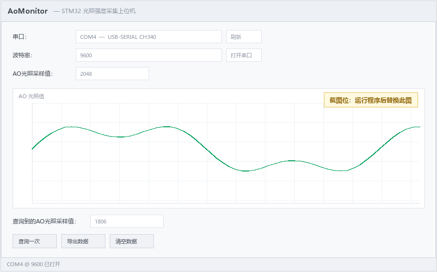

# AoMonitor — STM32 光照强度采集上位机

基于 **Qt 6 / Widgets** 的桌面串口上位机，配套 STM32F103C8T6 光敏采集节点：实时显示 ADC 光照值、绘制滚动波形、按需存库、导出 CSV。

下位机固件代码见同级仓库 `STM32-LightSensor`（江协科技 9-2 工程改造：光敏 DO 控蜂鸣器 + AO 上 OLED + AO 串口上报）。

---

## 功能

| 功能 | 说明 |
|---|---|
| **串口枚举** | 启动自动扫描，`QSerialPortInfo` 枚举，显示 `COM4 — USB-SERIAL CH340`；跨平台（Linux 显示 `/dev/ttyUSB0`），无需改代码 |
| **打开 / 关闭串口** | 同一按钮二次点击为关闭；失败按错误类型给提示（`PermissionError` → 被其他程序占用，`DeviceNotFoundError` → 设备已拔出） |
| **实时数值** | `AONumber` 显示每帧光照值（12 位 ADC，0~4095），约 5 帧/秒 |
| **滚动波形** | QtCharts `QLineSeries`，横轴窗口固定 300 点，满后整体左滚（示波器手感），纵轴 0~4095 |
| **查询一次** | 向上位机发一个字节，STM32 收到任意字节立即补发一帧 → 立刻刷新 `AONumber_2` 并写入数据库 |
| **按需入库** | SQLite 单文件 `ao_data.db`，**只有点「查询一次」的那一帧才入库**，200 ms 自动帧不落库，避免刷屏 |
| **导出 CSV** | 全表导出，UTF-8 + BOM，Excel 打开中文不乱码 |
| **清空数据** | 二次确认后 `DELETE FROM light_log` |

---

## 界面截图

<!-- 把截图保存为 docs/screenshot.png 后，下面这张图会自动显示 -->



> 截图位：运行程序、打开串口、遮挡/移开光源后截一张图，存为 `docs/screenshot.png` 即可。

---

## 硬件接线

主控为 STM32F103C8T6 最小系统板，上位机通过 **CH340 USB-TTL** 与 MCU 的 USART1 相连。

| STM32 引脚 | 连接对象 | 说明 |
|---|---|---|
| PA9 (USART1_TX) | CH340 RX | 数据上报 |
| PA10 (USART1_RX) | CH340 TX | 接收上位机查询字节 |
| PA0 (ADC1_IN0) | 光敏模块 AO | 模拟量，`GPIO_Mode_AIN`，ADC1 通道 0 |
| PB13 | 光敏模块 DO | 数字量，上拉输入（模块 DO 为开漏输出） |
| PB12 | 有源蜂鸣器 | 低电平触发 |
| PB8 / PB9 | OLED (I2C) | SCL / SDA |

| 光敏模块 | STM32 |
|---|---|
| VCC | 3.3V |
| GND | GND |
| AO | PA0 |
| DO | PB13 |

**串口参数：9600 / 8-N-1，无流控。**

> ⚠️ 江协科技原始工程默认就是 9600；若你自己改过固件波特率，记得让这里的下拉框与 MCU 侧 `USART_BaudRate` 保持一致，否则会出现「串口已打开但一帧都收不到」。

---

## 串口协议

ASCII 文本帧，便于串口助手直接观察：

```
$DATA,<AO>#\r\n
```

| 字段 | 含义 |
|---|---|
| `$` | 帧头 |
| `DATA` | 固定标识 |
| `<AO>` | 十进制无符号整数，PA0 的 12 位 ADC 原始值，0~4095 |
| `#` | 帧尾 |
| `\r\n` | 换行（上位机解析时忽略） |

**上报节奏**

- MCU 每 **200 ms** 主动上报一帧；
- 上位机发来**任意字节**（本程序发 `?`），MCU **立即补发一帧**——「查询一次」按钮就靠这个约定实现。

示例：

```
$DATA,2048#
$DATA,512#
```

### 切帧为什么不能靠 `readAll()` 一次性解析

`QSerialPort::readyRead` 给的是**字节流不是消息流**：一次可能只收到半帧（`$DATA,20`），也可能一次收到三帧半。因此程序内部维护缓冲区：

1. 所有到达字节累积进 `m_rx`（上限 4096 字节，防止坏帧下无限膨胀）；
2. 找 `$` 定位帧头，丢掉之前的噪声；
3. 找 `#` 定位帧尾——**找不到就 `return` 保留缓冲，等下一批数据拼上**（新手最常写错的地方：这里清空缓冲会导致永远拼不出完整帧）；
4. 切出帧后按 `,` 取数值，`toLongLong(&ok)` 用 `ok` 判断解析成败，失败帧丢弃。

---

## 数据存储

SQLite 数据库文件与 exe 同目录（`QCoreApplication::applicationDirPath() + "/ao_data.db"`），首次启动自动建表：

```sql
CREATE TABLE IF NOT EXISTS light_log (
    id    INTEGER PRIMARY KEY AUTOINCREMENT,
    ts    TEXT    NOT NULL,   -- ISO8601 带毫秒，如 2026-10-28T19:20:31.402
    value INTEGER NOT NULL    -- AO 原始值 0~4095
);
```

写入使用 `prepare` + `bindValue` 参数化，不做字符串拼接（防注入、免转义）。

导出 CSV 时写 UTF-8 **BOM**，否则 Excel 打开中文表头会乱码。

---

## 依赖

| 项 | 版本 / 说明 |
|---|---|
| Qt | **6.5+**（开发使用 6.8.3 LTS） |
| Qt 模块 | `Core`、`Widgets`、**`SerialPort`**、**`Charts`**、**`Sql`** |
| 编译器 | Windows: MinGW 13.1 64-bit；Linux: GCC |
| 构建 | CMake ≥ 3.19 + Ninja（或 MinGW Makefiles / Make） |

> `SerialPort`、`Charts` 不在 qt6-base 里，必须单独安装：
>
> - 官方在线安装器：勾选 `Qt Serial Port` 与 `Qt Charts`
> - 命令行补装（aqtinstall）：
>   ```bash
>   python -m aqt install-qt windows desktop 6.8.3 win64_mingw -m qtserialport qtcharts -O D:/Qt --archives qtserialport qtcharts
>   python -m aqt install-qt linux desktop 6.8.3 linux_gcc_64 -m qtserialport qtcharts -O ~/Qt
>   ```
> - Ubuntu 包管理器：
>   ```bash
>   sudo apt install qt6-base-dev qt6-serialport-dev qt6-charts-dev libgl1-mesa-dev
>   ```

---

## 编译

### Windows（Qt Creator）

1. 打开 `CMakeLists.txt`，Configure Project 时选 `Desktop Qt 6.8.3 MinGW 64-bit`；
2. `Ctrl+B` 构建，`Ctrl+R` 运行。

### Windows（命令行）

```bash
# 把 MinGW、Qt、CMake、Ninja 加进 PATH
export PATH="/c/Program Files/CMake/bin:/d/Qt/Tools/mingw1310_64/bin:/d/Qt/6.8.3/mingw_64/bin:$PATH"

cmake -S . -B build-release -G Ninja \
      -DCMAKE_BUILD_TYPE=Release \
      -DCMAKE_PREFIX_PATH=D:/Qt/6.8.3/mingw_64
cmake --build build-release
```

配置期若打印 `Configuring with Qt 6.8.3 (major 6)`，说明找对了 Qt。

### Linux

```bash
sudo apt update
sudo apt install -y build-essential cmake ninja-build \
                    qt6-base-dev qt6-serialport-dev qt6-charts-dev \
                    libgl1-mesa-dev libxkbcommon-dev

cmake -S . -B build-linux -DCMAKE_BUILD_TYPE=Release
cmake --build build-linux -j$(nproc)
./build-linux/AoMonitor
```

Linux 上用串口需要 `dialout` 权限，**加完组必须重新登录**：

```bash
sudo usermod -aG dialout $USER
```

> ⚠️ Windows 与 Linux 的构建目录不可混用（`CMakeCache.txt` 存的是绝对路径），本工程约定 Windows 用 `build*`、Linux 用 `build-linux`。

---

## 使用步骤

1. 板子上电，跑固件（9600 波特率那版），CH340 插 USB；
2. 启动程序，串口下拉框选中 `COM4 — USB-SERIAL CH340`，波特率 `9600`；
3. 点 **打开串口** → 按钮变「关闭串口」，`AONumber` 每 200 ms 跳数，波形从左往右生长；
4. 遮挡/移开光源观察数值变化；
5. 点 **查询一次** → 发一个 `?`，STM32 立刻补发一帧，`AONumber_2` 更新且该值写入数据库；
6. **导出数据** → 选路径存 CSV；**清空数据** → 确认后清表。

数据库位置：exe 同目录 `ao_data.db`，可用 [DB Browser for SQLite](https://sqlitebrowser.org/) 打开查看。

### 常见问题

| 现象 | 原因 |
|---|---|
| 打开串口报「被其他程序占用」 | 串口被独占。关掉串口调试助手（UWP 版关窗不退出进程，需任务管理器结束）、另一份本程序实例、虚拟机 USB 直通 |
| 串口打开但一帧都收不到 | 波特率不匹配（本机固件应为 9600）；或 TX/RX 接反 |
| 数值恒为 0 或 4095 | AO 未接线 / 光敏模块供电异常；用万用表量 AO 对 GND 电压应在 0~3.3V 变化 |
| 波形不动 | 横轴窗口未跟随数据平移（QtCharts 横轴是真实数值，必须 `setRange(min, min+299)` 整体平移，只改一头会导致新数据落在可视范围外） |
| Linux 打开串口 `Permission denied` | 未加 `dialout` 组或未重新登录 |

---

## 目录结构

```
AOMonitor/
├── CMakeLists.txt          # Qt6 + SerialPort + Charts + Sql
├── main.cpp                # QApplication + 主窗口
├── mainwindow.h/.cpp       # 全部业务逻辑：串口、切帧、图表、数据库、导出
├── mainwindow.ui           # 布局管理器（QVBoxLayout + QGridLayout），chartArea 提升为 QChartView
├── AoMonitor_zh_CN.ts      # 中文翻译源
└── README.md
```

### 关键设计点

- **`chartArea` 控件提升**：`.ui` 里放普通 `QWidget` 占位，Promote 成 `QChartView`（头文件 `<QtCharts/QChartView>`），界面仍可用 Designer 拖布局。
- **对象树管理内存**：`m_serial = new QSerialPort(this)`，父对象析构自动回收，`~MainWindow` 只 `delete ui`。
- **`m_pendingLog` 标志法**：点「查询一次」置位，下一帧解析成功即入库并清标志——200 ms 自动帧照常显示但不落库。
- **平台无关**：串口名走 `QSerialPortInfo::availablePorts()` 枚举，不硬编码 `COM4`，同一份代码 Windows/Linux 都能跑。

---

## Roadmap

- [ ] 波形支持暂停 / 缩放 / 多曲线
- [ ] 按时间段查询历史数据并回放
- [ ] 采集参数可配置（上报周期、量程标定）
- [ ] 打包安装程序（Inno Setup）

---

## License

个人学习项目，可自由参考。若引用江协科技教程代码，请遵循其原始授权。
